# 基于强化学习的足式机器人运动规划与控制：2024—2026 年研究综述

**对应课题：** Планирование и управление движением шагающих роботов на основе обучения с подкреплением (RL).

**检索截止日期：2026-10-10。** 本文选取 2024—2026 年代表性成果，以人形机器人为主，补充四足机器人工作；不是穷尽性系统综述。年份优先采用首次预印本年份，会议年份单独说明。2026 年新作中包含预印本，不能据此推断已被会议或期刊录用。本文依据论文、官方项目说明和仓库说明整理，未运行复现实验，也不将不同论文的指标直接排名。

## 1. 研究范围与核心概念

“足式机器人”包括双足、人形和四足机器人。运动规划决定路径、落脚位置、接触时序或全身参考轨迹；运动控制根据机器人当前状态生成执行指令，使其实现目标并保持稳定。

| 层次 | 典型输入 | 典型输出 | 核心问题 |
|---|---|---|---|
| 任务与路径规划 | 目的地、场景、任务要求 | 路径或局部目标 | 往哪里走？ |
| 运动与接触规划 | 地形、状态、局部目标 | 落脚点、接触序列、全身参考 | 如何通过？ |
| 运动控制 | 本体感知、参考、可选环境感知 | 关节目标或力矩 | 如何稳定执行？ |

这些层次可以显式拆分，也可以部分融合在一个策略中。视觉端到端策略不一定包含独立的规划器；通用动作跟踪器也不自动等于自主导航系统。学习式全身控制中的 WBC 有时泛指协调全身的策略，不应直接等同于基于逆动力学和 QP 的传统 WBC。

## 2. 代表性工作总览

| 工作 | 时间 | 主要方向 | 关键方法 | 实验范围与阅读重点 |
|---|---|---|---|---|
| SoloParkour [2] | 2024 / CoRL 2024 | 约束视觉 RL | 特权策略经验启动离策略视觉学习 | Solo-12 实机；约束与样本效率 |
| PIE [3] | 2024 | 四足视觉跑酷 | 隐式—显式双层估计 | 实机零样本迁移；感知误差 |
| ASAP [4] | 2025 | Sim-to-real | 真实数据学习残差动作模型，再微调策略 | 实机动态动作；动力学差异补偿 |
| GMT [5] | 2025 | 通用动作跟踪 | 自适应采样、Motion MoE | 单策略多动作；训练分布平衡 |
| BeyondMimic [6] | 2025 首发 | 跟踪与任务组合 | RL 跟踪、扩散蒸馏、推理时引导 | 动态实机动作与下游目标控制 |
| BFM [7] | 2025 | 行为基础模型 | CVAE、掩码在线蒸馏 | 可复用行为表示与多控制接口 |
| SONIC [8] | 2025 首发；2026 期刊版 | 规模化通用控制 | 扩大数据、模型与计算；统一动作接口 | 实机全身控制与规划器/VLA 接入 |
| RGMT [9] | 2026-01 | 鲁棒通用跟踪 | 动力学条件化注意力、恢复课程 | 未见动作、扰动和实机恢复 |
| Walk the PLANC [10] | 2026-01 | 落脚规划＋RL | 降阶规划器、CLF 奖励 | 实机受限落脚区域行走 |
| ULTRA [15] | 2026-03 首发；IROS 2026 | 感知与目标驱动的全身操作 | 物理重定向、跟踪教师、多模态蒸馏、RL 微调 | G1 搬运与稀疏目标执行；同一套策略参数 |
| Scaling BFM [11] | 2026-07 | 通用控制扩展 | 全局跟踪、交互数据扩展、Humanoid Transformer | 仿真与实机；规模化训练机制 |
| PGMT [12] | 2026-09 | 地形感知跟踪 | 动作相关地形编码、跟踪约束放宽 | G1 复杂地形、恢复与遥操作 |
| ViBe [16] | 2026-09 | 预训练运动基座＋视觉适配 | 冻结 SONIC 与视觉编码器，RL 训练提取器及 LoRA | G1 行走、操作与躲球；不同任务分别适配 |
| PASSAGE [13] | 2026-09 | 全身通过规划 | 场景对齐数据、流匹配规划、RL 后训练 | 机载感知与拥挤场景通过 |
| Generate, Track, Improve [14] | 2026-09 | 生成式规划＋RL | 深度图条件流匹配、跟踪策略、离策略微调 | G1 室外多技能运动 |
| iGPC [17] | 2026-10 | 运动先验＋感知接触交互 | 保留 GPC 基座，任务适配、感知蒸馏与输入校准 | G1 接触目标、扶撑稳定与推箱；无需执行参考动作 |

> **方法图说明（2026-10-12 补充）：**下文收录上述 16 篇论文的方法管线或模型架构原图，分别放在对应讲解之后。图片保存在本地 `assets/paper-pipelines/`，点击来源可查看对应论文版本与图号；图片版权归原作者所有。图下注释是本综述的中文阅读提示。图片采用各图标注的版本，不代表已对综述正文完成新一轮文献核验。

## 3. 从敏捷运动到通用身体控制

### 3.1 SoloParkour 与 PIE

SoloParkour [2] 将四足跑酷建模为约束 RL：先以特权环境信息学习策略，再利用其经验启动从深度图训练的离策略算法，并部署到 Solo-12。其价值在于将物理限制和视觉学习成本纳入训练设计。PIE [3] 则通过隐式—显式估计改善对本体状态和环境的理解，并展示一阶段仿真训练后的实机迁移。

**SoloParkour 方法图**

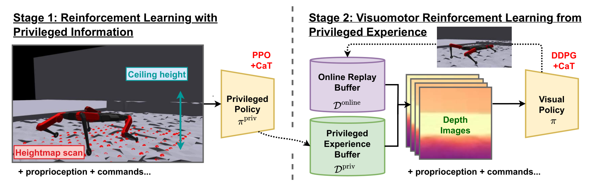

*来源：[SoloParkour，arXiv 2409.13678v1，图 3](https://arxiv.org/html/2409.13678v1#S3.F3)。*

读图提示：先用特权信息训练策略，再利用其经验训练深度视觉策略；两阶段都引入约束。

**PIE 方法图**

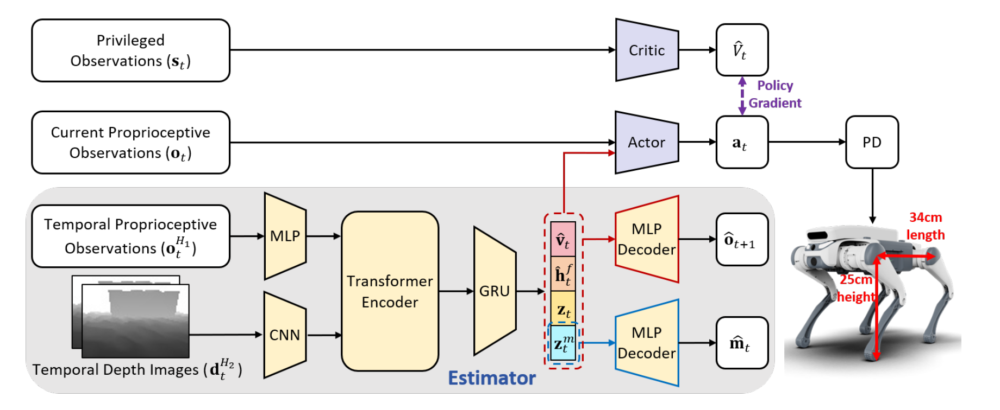

*来源：[PIE，arXiv 2408.13740v3，图 2](https://arxiv.org/html/2408.13740v3#S2.F2)。*

读图提示：本体历史与深度图进入估计器，提取隐式与显式状态，再供策略使用。

### 3.2 ASAP：让真实数据改善仿真训练

ASAP [4] 先在仿真中学习人体动作重定向后的跟踪策略，再收集真实执行数据，训练补偿动力学差异的残差动作模型。随后把该模型加入仿真并微调控制策略。

它与普通域随机化的区别在于：补偿包含从真实执行数据中学习到的信息。该思路适合研究执行器、接触及其他建模误差导致的跟踪偏差；实际复现需考虑真实数据采集和机器人硬件条件。

**ASAP 方法图**

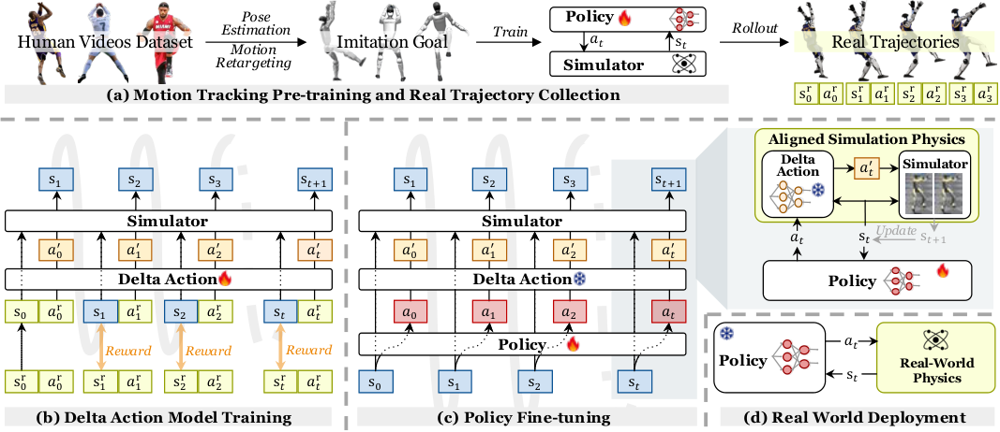

*来源：[ASAP，arXiv 2502.01143v3，图 2](https://arxiv.org/html/2502.01143v3#S0.F2)。*

读图提示：先训练并采集实机轨迹，再学习残差动作模型，最后在修正后的仿真中微调策略。

### 3.3 GMT、BeyondMimic、BFM 与 SONIC 的区别

| 工作 | 核心关注点 | 不应混淆的概念 |
|---|---|---|
| GMT [5] | 用自适应采样与 MoE 统一多动作跟踪 | 动作覆盖范围不等于环境适应范围 |
| BeyondMimic [6] | 高质量跟踪，并通过扩散模型组合技能、接受任务引导 | 跟踪训练仓库不等于整篇扩散控制实现 |
| BFM [7] | 学习可复用行为潜空间和多条件控制接口 | “基础模型”不是某个固定网络结构的同义词 |
| SONIC [8] | 系统扩大数据、模型和计算，获得通用跟踪能力 | tracker、运动学 planner 和 VLA 分别承担不同功能 |

BeyondMimic 同时包含动作获取与下游任务控制两个层面。BFM 的初始工作采用 CVAE 与掩码在线蒸馏。SONIC 将规模化动作跟踪与统一接口结合起来，其官方页面同时展示运动学规划和高层模型接入。这些成果共同推动了可复用全身控制，但不能仅依据展示视频判断跨地形或长时任务可靠性。

**GMT 方法图**

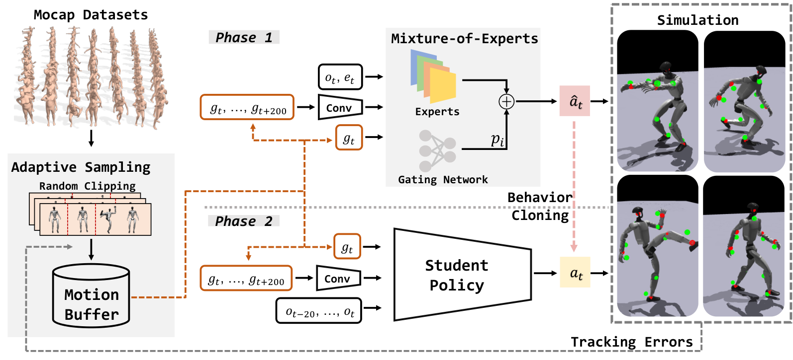

*来源：[GMT，arXiv 2506.14770v2，图 3](https://arxiv.org/html/2506.14770v2#S3.F3)。*

读图提示：动作自适应采样与专家混合模型用于训练，再通过行为克隆得到学生策略。

**BeyondMimic 方法图**

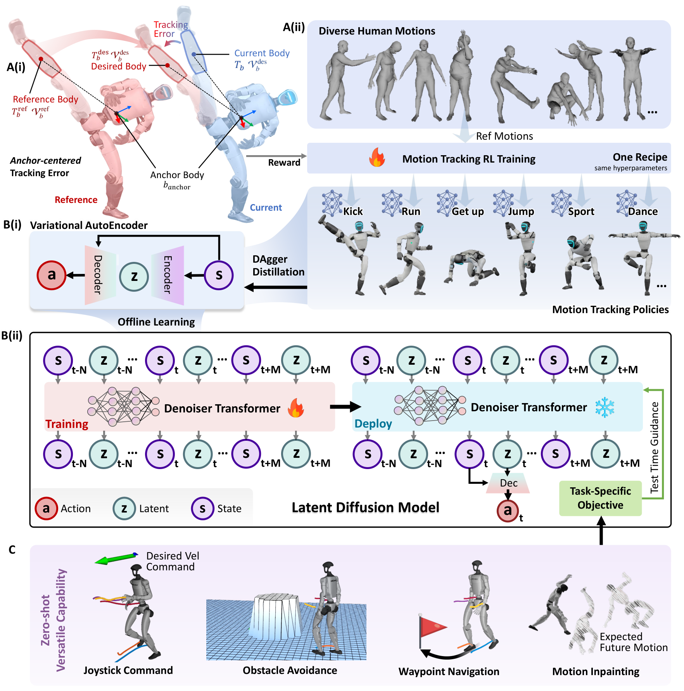

*来源：[BeyondMimic，arXiv 2508.08241v4，图 7](https://arxiv.org/html/2508.08241v4#Sx3.F7)。*

读图提示：从动作跟踪策略出发，经潜空间蒸馏和扩散建模，在推理时加入任务引导。

**BFM 方法图**

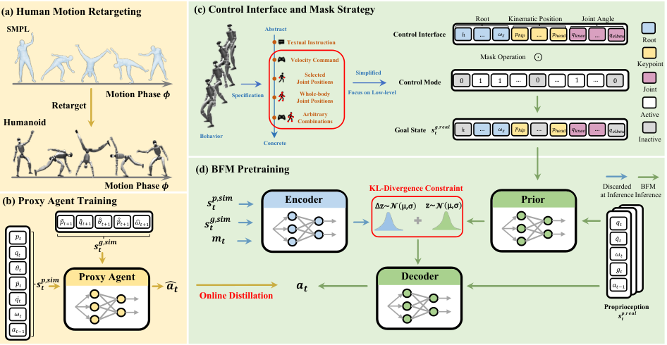

*来源：[BFM，arXiv 2509.13780v1，图 2](https://arxiv.org/html/2509.13780v1#S3.F2)。*

读图提示：重定向数据训练代理策略；统一控制接口、输入掩码与 CVAE 蒸馏形成行为模型。

**SONIC 方法图**

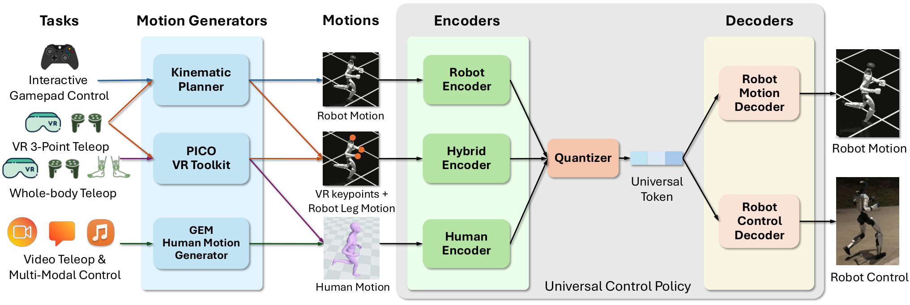

*来源：[SONIC，arXiv 2511.07820v4，图 6](https://arxiv.org/html/2511.07820v4#S3.F6)。*

读图提示：不同动作来源经专门编码器转换为统一词元，再由运动解码器和控制解码器使用。

## 4. 2026 年重点进展

### 4.1 RGMT：不完美参考下的鲁棒跟踪

RGMT [9] 根据近期本体感知，通过因果时序编码器和交叉注意力聚合参考动作窗口，使参考信息的使用与当前动力学状态相关。同时加入随机不稳定初始化和逐渐减弱辅助力的恢复课程。

作者报告约 3.5 小时动作数据、单阶段且无需蒸馏的训练，以及未见动作和实机迁移。这里的数据量是参考动作规模，不能据此推断总训练交互量或 GPU 成本很低。

**RGMT 方法图**

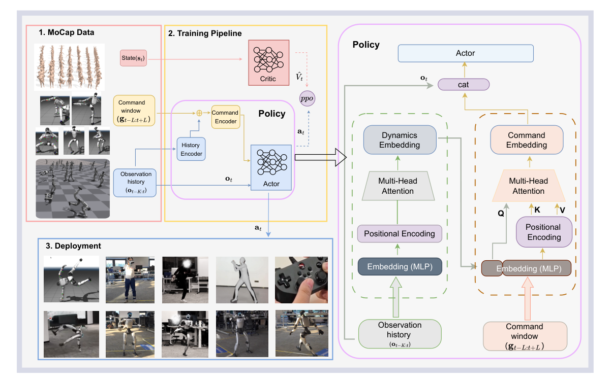

*来源：[RGMT，arXiv 2601.23080v1，图 2](https://arxiv.org/html/2601.23080v1#S1.F2)。*

读图提示：用本体历史提取动力学信息，再结合参考动作窗口，为当前状态生成合适的控制动作。

### 4.2 Walk the PLANC：给 RL 明确的物理规划结构

PLANC [10] 面向踏脚石、窄板等受限落脚区域。降阶步态规划器提供动力学一致的目标，CLF 奖励引导 RL 学习，最后在实机验证。

它提供了一个适合控制背景的研究入口：保留可解释的规划结构，让 RL 补充对误差和复杂动力学的适应能力。论文采用 CLF 奖励并不意味着可以直接宣称整个学习系统拥有全局稳定性保证；这需要检查其理论假设与证明范围。

**Walk the PLANC 方法图**

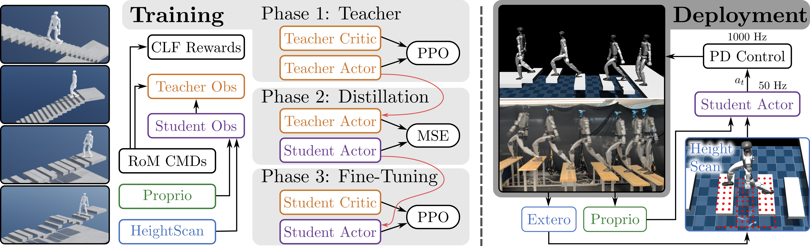

*来源：[Walk the PLANC，arXiv 2601.06286v1，图 2](https://arxiv.org/html/2601.06286v1#S1.F2)。*

读图提示：降阶模型提供参考与 CLF 奖励，经过教师训练、学生蒸馏和微调后部署。

### 4.3 Scaling BFM：动作数量、交互数据与模型结构协同扩展

Scaling BFM [11] 强调三项协同设计：全局坐标系下的整体行为跟踪、on-policy rollout 数量与参考动作多样性的配合，以及 Humanoid Transformer。它提示研究者区分“参考数据集规模”和“RL 实际交互数据量”，二者不是同一个概念。

**Scaling BFM 方法图**

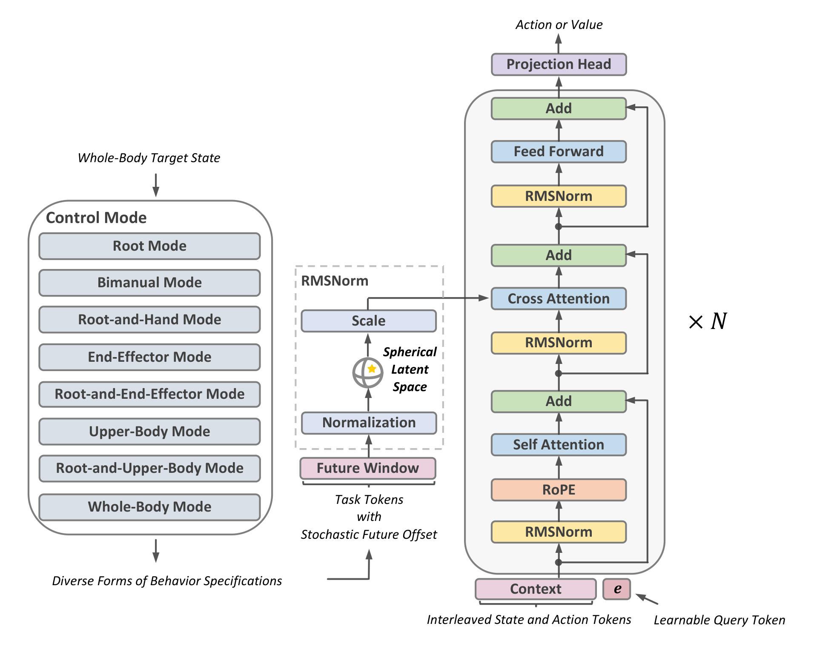

*来源：[Scaling BFM，arXiv 2607.15163v1，图 3](https://arxiv.org/html/2607.15163v1#S3.F3)。*

读图提示：不同控制目标形成任务词元，与状态和动作上下文通过 Humanoid Transformer 交互；此图为模型架构图。

### 4.4 PGMT：允许为地形调整动作

PGMT [12] 接收本体状态及历史、未来参考动作和局部地形高度图，输出全身关节目标。它先学习平地跟踪与恢复，再引入动作相关的地形编码，让原本不适合当前地面的参考动作得到调整。G1 实机展示包含最高 37 cm 障碍条件下的动作执行。

它明确规定部分调整范围：坡面、台阶和箱体上，下肢的位置、姿态及关节位置跟踪目标可以放松，上肢等其余目标保留原有要求。这通过奖励实现，不是硬约束保证。上肢、下肢、地形等多个 critic 头分别评价收益，但部署只有一个 actor；运动、遥操作和恢复不依赖多个策略切换。

任务边界是“给定运动意图，依据地形协调执行”。论文已展示上楼同时遥操作上肢；仅增加这种组合不足以构成新意。高度图主要表达几何，对物体语义和交互用途的理解仍有限。评估需同时衡量地形通过与动作保持。

**PGMT 方法图**

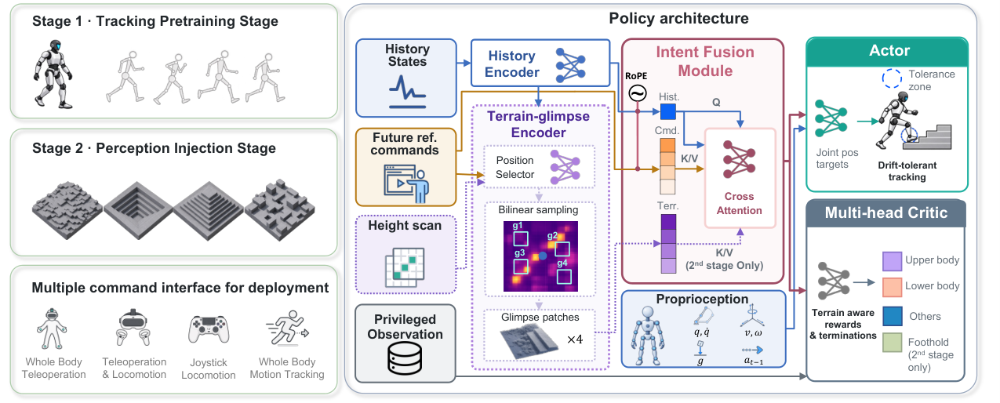

*来源：[PGMT，arXiv 2609.08511v2，图 2](https://arxiv.org/html/2609.08511v2#S1.F2)。*

读图提示：先学习动作跟踪与恢复，再注入地形感知；多头 critic 用于训练，actor 负责执行。

### 4.5 PASSAGE 与 Generate, Track, Improve：规划器接受闭环 RL 反馈

PASSAGE [13] 利用 100 小时、1,500 个场景中的场景对齐人体动作，训练条件流匹配规划器，并结合感知跟踪器和规划器 RL 后训练。其机载系统在 50 个未见真实布局中测试，强调根据几何环境选择和组合全身通过行为。

Generate, Track, Improve [14] 从深度图生成全身参考，由感知 RL 策略跟踪，再通过离策略 RL 改善生成器。作者报告部分测试条件下通过率最多增加 25 个百分点，并展示 G1 室外多技能运动。该数字是论文内部实验结果，不应直接与其他工作不同测试集的成功率比较。

二者反映出一个值得研究的方向：规划器不仅拟合示范动作，还利用实际执行反馈学习“哪些动作能够被当前控制器可靠完成”。

**PASSAGE 方法图**

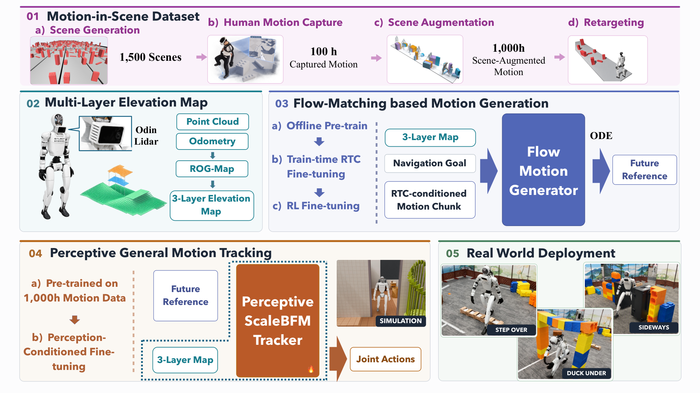

*来源：[PASSAGE，arXiv 2609.18732v1，图 2](https://arxiv.org/html/2609.18732v1#S2.F2)。*

读图提示：场景对齐数据、分层高度图、流匹配运动生成器与感知跟踪器组成闭环执行流程。

**Generate, Track, Improve 方法图**

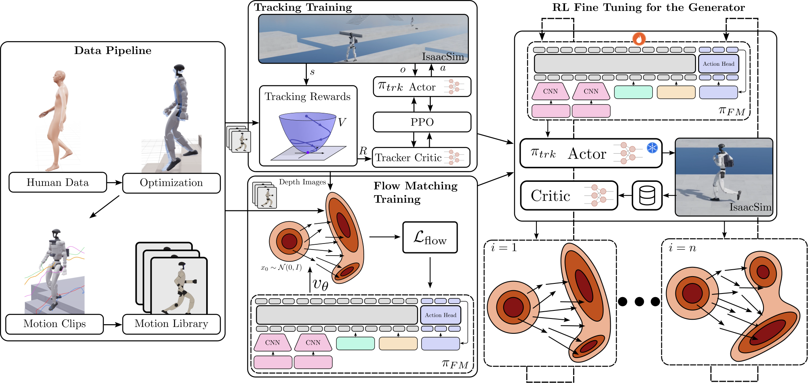

*来源：[Generate, Track, Improve，arXiv 2609.31577v1，图 2](https://arxiv.org/html/2609.31577v1#S2.F2)。*

读图提示：动作库用于训练跟踪器与流匹配生成器，再用闭环执行得到的反馈微调生成器。

### 4.6 ULTRA：同一策略支持动作跟踪和视觉目标执行

ULTRA [15] 区分两种任务输入：密集参考指定中间动作；稀疏目标主要指定机器人身体或物体最终应达到的位姿，留下中间运动的自由度。例如搬箱子时，可以提供完整示范轨迹，也可以只提供箱子的目标位置。

训练依次包括物理一致的动作重定向、完整状态下的跟踪教师、多模态学生蒸馏和目标执行的 RL 微调。学生训练时随机隐藏部分输入，学习在参考或观测缺失时工作。部署用同一套学生参数，支持参考跟踪、稀疏目标控制和深度点云感知；教师与学生是训练关系，不是执行时的策略切换。

实验包含物体尺度、目标位置变化和组合动作。这些结果不能直接替代“训练中严格排除某些同时约束组合”的检验。ULTRA 属于更广义的运动能力与感知融合，不宜描述成 ViBe 式冻结运动基座、只训练适配器的方法。

**ULTRA 方法图**

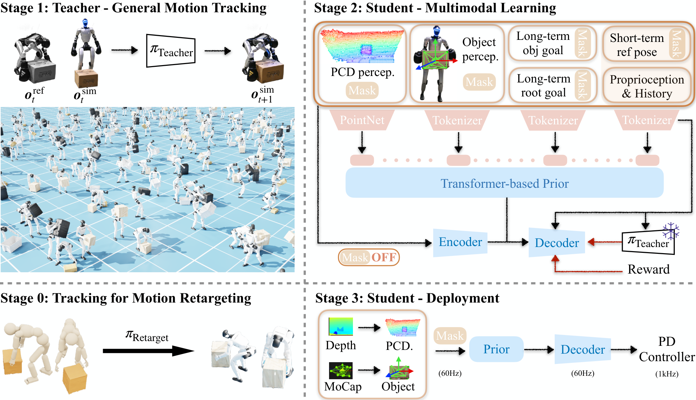

*来源：[ULTRA，arXiv 2603.03279v2，图 2](https://arxiv.org/html/2603.03279v2#S2.F2)。*

读图提示：物理重定向、跟踪教师、多模态学生学习与部署依次衔接，学生接收感知和不同密度的目标。

### 4.7 ViBe：冻结运动基座，通过视觉学习局部调整

ViBe [16] 复用 SONIC 全身跟踪器与预训练视觉编码器，冻结两者，使用 PPO 训练视觉信息提取器及 LoRA 适配器。控制器接收本体历史、参考动作窗口、机载 RGB 图像及可选任务指令。视觉反馈直接影响动作，使机器人调整落脚、接触位置或躲避行为。

论文采用相同架构与训练方法，但不同任务分别训练适配策略。行走、搬运、翻方块和躲球的演示不等于一套共同权重覆盖全部任务。在翻方块实验中，简单规划器选择“右翻、右翻、前翻”的参考片段，直到指定颜色朝上；这里换的是参考动作，不能直接解释为切换多个控制策略。

它是“冻结预训练运动基座＋预训练视觉＋少量模块 RL 适配”的直接先例。跨任务共用适配模块及未见任务组合泛化，需要另行验证。

**ViBe 方法图**

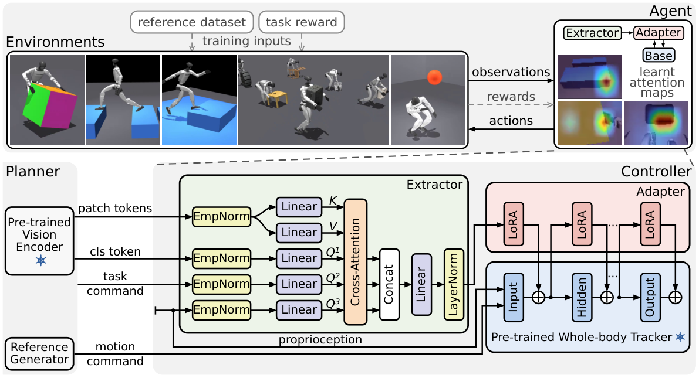

*来源：[ViBe，arXiv 2609.09918v1，图 2](https://arxiv.org/html/2609.09918v1#S2.F2)。*

读图提示：视觉提取器读取冻结视觉编码器的特征，通过 LoRA 适配冻结的运动跟踪器；不同任务分别适配。

### 4.8 iGPC：保留生成式运动基座，接入感知交互

iGPC [17] 在 GPC 的运动词元表示、生成式先验与动作解码器上，学习任务适配器，加入物体表面几何、接触和稳定性条件。交互专家学习接触指定目标、利用环境扶撑及推动物体，执行时无需预设参考动作。

感知学生利用深度、LiDAR 和本体历史重建专家所需输入，同时学习运动词元和关节目标，再进行有界输入校准与任务适配器 RL 微调。它保留运动基座及解码器，而非用一个新动作网络替代基座。

不同任务仍使用任务适配器；共享基座不能直接视为统一策略的未见组合泛化。论文采用 Isaac Lab，并在部分学生推箱评估中使用 MuJoCo，不能据此说全部训练基于 MuJoCo。更广泛的泛化与接触安全评估仍是作者提出的后续方向。

**iGPC 方法图**

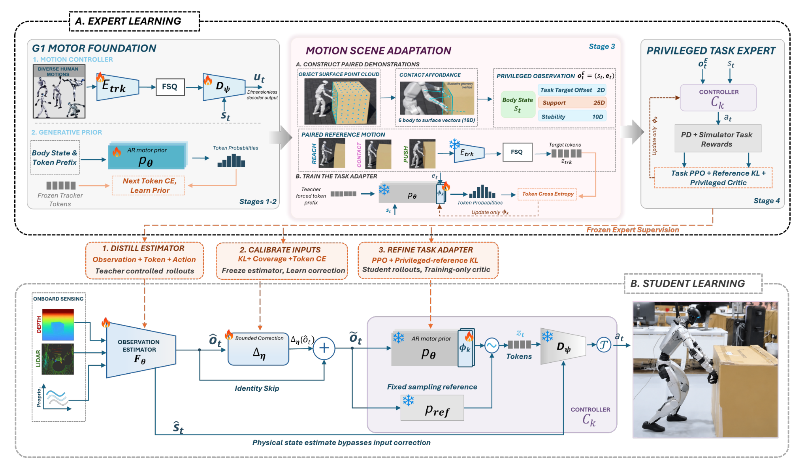

*来源：[iGPC，arXiv 2610.08120v1，图 2](https://arxiv.org/html/2610.08120v1#S2.F2)。*

读图提示：先在运动基座上训练交互专家，再进行感知学生蒸馏、输入校准与任务适配器微调。

### 4.9 四项工作的接口与泛化边界

| 工作 | 感知输入 | 任务接口 | 策略组织 | 选题时必须区分的边界 |
|---|---|---|---|---|
| PGMT [12] | 地形高度图 | 参考动作或由上层转换的运动命令 | 一个全身 actor；多个 critic 头 | 已有地形适应和上楼时上肢控制；不同于稀疏任务约束的严格组合留出 |
| ULTRA [15] | 深度点云或物体状态等 | 密集参考或身体／物体稀疏目标 | 同一套多模态学生参数 | 已有目标执行和组合动作；单策略本身不是新意 |
| ViBe [16] | RGB 与预训练视觉特征 | 参考窗口及可选任务指令 | 不同任务分别训练适配策略 | 共用架构与基座，不等于全部任务共用参数；选择参考片段不等于换策略 |
| iGPC [17] | 深度、LiDAR、本体历史 | 目标与交互条件；执行无需参考动作 | 保留 GPC 基座，使用任务适配器 | 已有基座复用、感知交互和无参考执行；组合泛化需要额外证据 |

“运动基座＋感知”已经是一条有先例的技术路线。任务边界应明确控制器接收什么、负责什么、怎样判定成功；泛化边界还必须明确哪些因素或组合在训练中出现过。无配对示范，不代表该组合从未在 RL 采样中出现；多任务展示，也不自动证明未见任务组合泛化。

## 5. 开源与复现情况

以下只记录本次检索确认的官方入口。提供仓库入口不代表代码、权重、数据、训练和实机部署全部齐备；本文没有安装或运行这些仓库。

| 工作 | 已核实入口 | 范围或待检查事项 |
|---|---|---|
| ASAP | [官方仓库](https://github.com/LeCAR-Lab/ASAP) | 已有实现说明；需核对硬件与真实数据采集要求 |
| BeyondMimic | [跟踪训练仓库](https://github.com/HybridRobotics/whole_body_tracking) | 仓库明确覆盖动作跟踪训练；扩散部分需独立核实 |
| Scaling BFM | [官方仓库](https://github.com/zengweishuai/ScaleBFM) | 已确认官方入口；本次未逐项检查发布完整性 |
| SONIC | [官方项目](https://nvlabs.github.io/GEAR-SONIC/) | 页面提供 Code 与 Docs；具体模型和训练资产需逐项检查 |
| SoloParkour | [官方项目](https://gepetto.github.io/SoloParkour/) | 页面提供代码入口；需核对安装与数据依赖 |
| PLANC | [官方项目](https://caltech-amber.github.io/planc/) | 页面提供代码链接，但本次未成功读取目标仓库内容 |
| PGMT | [官方项目](https://luyili.github.io/pgmt/) | 已核实的 [GitHub 仓库](https://github.com/LuyiLi/pgmt) 为项目网站；本次未确认完整训练代码 |
| ULTRA | [官方仓库](https://github.com/Sirui-Xu/ULTRA) | 提供重定向、教师、学生及微调脚本；训练使用 IsaacGym，另有 MuJoCo sim-to-sim 入口。发布教师权重含论文之后扩展的数据，需核对实验对应关系 |
| ViBe | [官方仓库](https://github.com/lok-i/vibe) | 基于 mjlab／MuJoCo-Warp；有训练、回放、模型与导出入口。发布模型按任务区分，需取得 SONIC、视觉模型及动作数据依赖 |
| iGPC | [论文](https://arxiv.org/abs/2610.08120) | 本次未确认作者公开的完整训练仓库，不标记为已完整开源 |
| 其他条目 | 见文末论文及项目 | 本次未确认完整可运行代码，不标记为“已完整开源” |

开始复现前，应确认仿真器及版本、机器人模型与关节顺序、动作重定向流程、观测与动作尺度、训练资源、权重和数据可获取性，以及 sim-to-sim/实机部署入口。使用同一机器人名称不意味着控制配置可以直接互换。

## 6. 可开展的研究问题

下面是基于上述文献提出的研究设想，不是已经证实的结论，也不是已确认无人研究的空白。

### 方向 A：根据地形和当前状态动态放宽跟踪目标

**问题：**参考动作不适合当前地形时，固定跟踪权重可能导致碰撞；过度放宽又可能丢失动作意图。

**假设：**根据地形、本体历史与跟踪误差动态调整局部目标或权重，可提高通过率，同时保留可接受的动作相似度。

**最小实验：**在统一基线上比较固定权重、人工地形规则和学习式调整；采用未见台阶、沟隙及不同噪声等级。报告通过率、跌倒率、接触违规、姿态误差和任务完成时间，并跨多个训练种子统计。

**与已有工作的重叠：**PGMT [12] 已有地形相关的下肢跟踪放松。单纯提出“根据地形放宽参考”不能作为新意；需要具体说明新机制、适用约束及与 PGMT 的差别。

### 方向 B：物理落脚规划＋残差 RL

**问题：**显式落脚规划对模型和感知误差敏感，而直接速度控制缺乏落脚位置约束。

**假设：**保留降阶规划目标，并让 RL 学习有限幅度的补偿，可提高受限落脚场景中的可靠性。

**最小实验：**比较速度跟踪 RL、落脚条件 RL，以及规划＋残差 RL。在相同训练预算和扰动条件下，报告落脚误差、越界率、通过率、动作平滑性及控制计算耗时。残差幅度应设置消融，检验策略是否绕过规划器。

### 方向 C：以执行成功反馈改进运动生成器

**问题：**生成器可能输出统计上自然但当前机器人无法完成的动作。

**假设：**使用固定 tracker 的执行反馈微调生成器，可以改善闭环成功率。

**最小实验：**比较原始生成器、只调整 tracker 和只微调生成器。区分生成质量、动力学可执行性与任务成功率，并测试未见几何环境，避免只在训练场景中获得收益。

### 方向 D：感知驱动的未见任务约束组合

**问题：**复用运动基座和一个共享感知适配模块，能否在不为每个组合重新训练的情况下，同时满足训练中未曾共同出现的任务约束？例如见过“空手上楼”和“平地搬运且保持物体水平”，测试“上楼时搬运且保持水平”。这是待检验设想，尚未确认其文献新意。

**假设：**显式表示可组合的身体／物体目标与场景约束，并让共享全身策略处理它们的耦合，可改善未见组合的成功率。PGMT [12]、ULTRA [15]、ViBe [16] 和 iGPC [17] 是必须比较的相关工作，不能仅以单策略、感知或无参考执行作为贡献。

**最小实验：**固定机器人和感知输入，列出环境条件与任务约束的训练／测试矩阵。测试组合从示范、基座预训练、RL 采样、教师与蒸馏中全部排除；各单项因素在训练中出现。比较同输入同数据的直接拼接策略、共享适配策略和训练过全部组合的性能上界。报告所有约束同时满足的成功率、跌倒与碰撞、物体姿态误差，以及已见／未见组合差距；用真实几何输入与视觉输入的对照区分控制问题和感知问题。

## 7. 阅读与实现建议

建议按 BeyondMimic → ASAP → PLANC → PGMT → Generate, Track, Improve 阅读：先掌握动作跟踪，再理解实机差异，然后进入落脚规划、地形适应与规划器优化。

面向“运动基座＋感知＋任务泛化”，可按 SONIC → ViBe → PGMT → ULTRA → iGPC 阅读。重点记录任务输入、参考依赖、哪些参数共用、哪些模块逐任务训练，以及测试变化是否在训练中真正被排除。

如果计算资源有限，第一阶段宜选择一个已发布代码的基线，固定机器人、训练预算和任务范围，复现其基本行为并记录失败案例。随后围绕一个具体机制做消融。直接从零复现大规模行为基础模型需要另行评估数据和算力，不宜只凭论文演示决定。

## 8. 参考文献与官方链接

2. **SoloParkour: Constrained Reinforcement Learning for Visual Locomotion from Privileged Experience.** CoRL 2024. [论文](https://arxiv.org/abs/2409.13678) · [项目](https://gepetto.github.io/SoloParkour/)。PMLR 卷出版于 2025 年，会议为 CoRL 2024。
3. **PIE: Parkour with Implicit-Explicit Learning Framework for Legged Robots.** 2024. [论文](https://arxiv.org/abs/2408.13740)
4. **ASAP: Aligning Simulation and Real-World Physics for Learning Agile Humanoid Whole-Body Skills.** 2025. [论文](https://arxiv.org/abs/2502.01143) · [项目](https://agile.human2humanoid.com/)
5. **GMT: General Motion Tracking for Humanoid Whole-Body Control.** 2025. [论文](https://arxiv.org/abs/2506.14770) · [项目](https://gmt-humanoid.github.io/)
6. **BeyondMimic: From Motion Tracking to Versatile Humanoid Control via Guided Diffusion.** 2025 首发. [论文](https://arxiv.org/abs/2508.08241) · [项目](https://beyondmimic.github.io/)
7. **Behavior Foundation Model for Humanoid Robots.** 2025. [论文](https://arxiv.org/abs/2509.13780) · [项目](https://bfm4humanoid.github.io/)
8. **SONIC: Supersizing Motion Tracking for Natural Humanoid Whole-Body Control.** 2025 首发，Science Robotics 2026. [预印本](https://arxiv.org/abs/2511.07820) · [项目](https://nvlabs.github.io/GEAR-SONIC/)
9. **Robust and Generalized Humanoid Motion Tracking.** 2026. [论文](https://arxiv.org/abs/2601.23080) · [项目](https://zeonsunlightyu.github.io/RGMT.github.io/)
10. **Walk the PLANC: Physics-Guided RL for Agile Humanoid Locomotion on Constrained Footholds.** 2026. [论文](https://arxiv.org/abs/2601.06286) · [项目](https://caltech-amber.github.io/planc/)
11. **Scaling Behavior Foundation Model for Humanoid Robots.** 2026. [论文](https://arxiv.org/abs/2607.15163) · [项目](https://scalebfm.github.io/)
12. **PGMT: Perceptive General Motion Tracking for Humanoid Robots.** 2026. [论文](https://arxiv.org/abs/2609.08511) · [项目](https://luyili.github.io/pgmt/)
13. **PASSAGE: Scaling Scene-Aligned Motion Learning for Perceptive Humanoid Traversal in Cluttered Environments.** 2026. [论文](https://arxiv.org/abs/2609.18732)
14. **Generate, Track, Improve: Perceptive Multi-Skill Humanoid Locomotion with RL-Fine-Tuned Motion Generators.** 2026. [论文](https://arxiv.org/abs/2609.31577) · [项目](https://zolkin1.github.io/generate-track-improve/)
15. **ULTRA: Unified Multimodal Control for Autonomous Humanoid Whole-Body Loco-Manipulation.** 2026-03 首发，IROS 2026；本次解释采用 2026-09 更新的 v2。 [论文](https://arxiv.org/abs/2603.03279) · [正文 v2](https://arxiv.org/html/2603.03279v2) · [官方仓库](https://github.com/Sirui-Xu/ULTRA)
16. **ViBe: Visual Behavior Adaptation for Perceptive Humanoid Whole-Body Control.** 2026-09. [论文](https://arxiv.org/abs/2609.09918) · [项目](https://lok-i.github.io/vibe-control/) · [官方仓库](https://github.com/lok-i/vibe)
17. **iGPC: Generative Motion Priors for Object-Aware Humanoid Interaction.** 2026-10. [论文](https://arxiv.org/abs/2610.08120) · [正文](https://arxiv.org/html/2610.08120v1)
